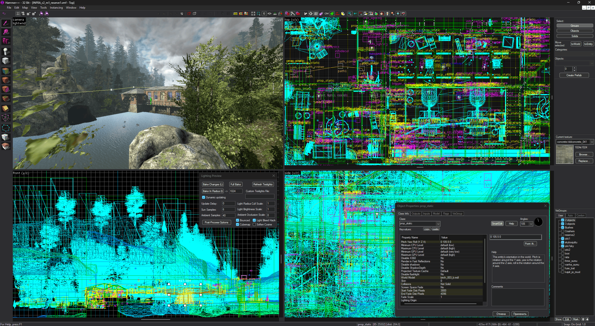

<p align="center"></p>

English Version | [Русская версия](README_ru.md)

If you are looking for the repacker based on CS:GO, go to [HammerPlusPlus-INFRA-RePacker](https://github.com/Michael-Soyka/HammerPlusPlus-INFRA-RePacker).

## Installation

**Hammer++ must be closed.**

1. Install [INFRA](https://store.steampowered.com/app/251110/INFRA/);
2. Download [Hammer++ for Portal 2](https://ficool2.github.io/HammerPlusPlus-Website/download.html) and unpack it next to the patcher;
3. Run **infra-hpp-patcher.exe** (if the game is installed and the Hammer++ for Portal 2 folder lies next to the patcher, both are filled in automatically, otherwise pick them manually);
4. Press **Install**;

Optionally, you can install the compatible with this patcher [Extra Dark](https://github.com/Michael-Soyka/HammerPlusPlus-ExtraDark) theme.

## Showcase


<p align="center">Hammer++ - INFRA</p>

## Requirements

### General

- INFRA from Steam
- Hammer++ for Portal 2, 32-bit: the patcher accepts only this build

### For developers

- Rust, stable, with the 32-bit target: `rustup target add i686-pc-windows-msvc`
- Visual Studio \>=2022 or Build Tools with the "Desktop development with C++" workload: the MSVC linker and the Windows SDK

## Building

```
cargo build --release -p infra_hpp_adapter --target i686-pc-windows-msvc
cargo build --release -p infra_hpp_patcher
```

The result is `target\release\infra-hpp-patcher.exe` with the 32-bit `infra_hpp_adapter.dll` inside: the first command builds the adapter, the second embeds it into the patcher.

The patcher addresses are in [ADDRESSES.md](ADDRESSES.md).

## Authors

- Loiste Interactive - Creators of [INFRA](https://loisteinteractive.com)
- Ficool2 - Creator of the [Hammer++](https://ficool2.github.io/HammerPlusPlus-Website/) :blue_heart:
- Michael Soyka (Moon-6) - Structure, proj direction, tests
- Claude - General patcher code
