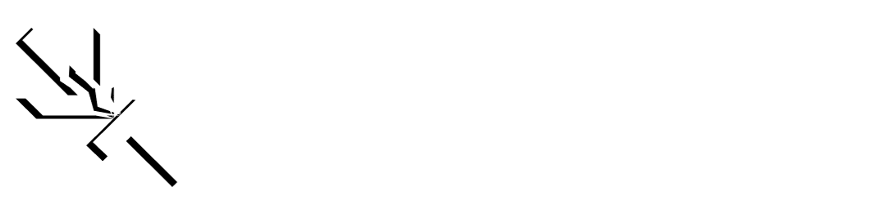
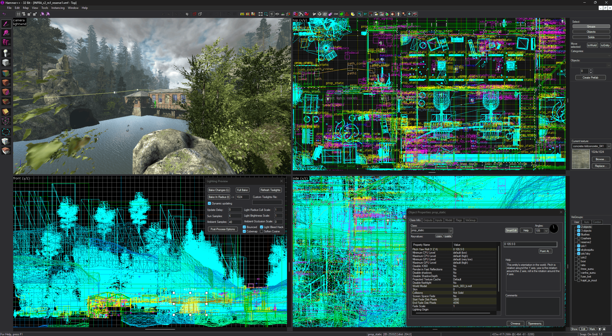

<p align="center"></p>

English Version | [Русская версия](README_ru.md)

## Installation

Note before installing: if you use Windows older than 10, use the CLI version.

### GUI

1. Install [INFRA](https://store.steampowered.com/app/251110/INFRA/);
2. Download [Hammer++ for Portal 2](https://ficool2.github.io/HammerPlusPlus-Website/download.html) and unpack it next to the patcher;
3. Run **infra-hpp-patcher.exe** (if the game is installed and the Hammer++ for Portal 2 folder lies next to the patcher, both are filled in automatically, otherwise specify them manually or drag them onto the path field);
4. Press **Install**;

### CLI

Note: the CLI is also included in the GUI version.

```
infra-hpp-patcher-cli.exe --help

infra-hpp-patcher-cli.exe install [--game <folder>] [--hpp <folder>] [--shortcut]
infra-hpp-patcher-cli.exe remove  [--game <folder>] [--close]
infra-hpp-patcher-cli.exe launch  [--game <folder>]
infra-hpp-patcher-cli.exe status  [--game <folder>]
```

Optionally, you can install the compatible with this patcher [Extra Dark](https://github.com/Michael-Soyka/HammerPlusPlus-ExtraDark) theme.

## Showcase


<p align="center">Hammer++ - INFRA</p>

[Design on Figma](https://www.figma.com/design/zUpakDBp6vfcbPzCPseVBF/Source-Mini-Tools?node-id=0-1&t=rR9ijBfBiP36KZYt-1)

## Requirements

### General

- INFRA from Steam
- Hammer++ for Portal 2

### For developers

- Rust, stable, with the 32-bit target: `rustup target add i686-pc-windows-msvc`
- Visual Studio \>=2022 or Build Tools with the "Desktop development with C++" workload: the MSVC linker and the Windows SDK

## Building

```
cargo build --release
```

The result is `infra-hpp-patcher.exe` and `infra-hpp-patcher-cli.exe` in `target\i686-pc-windows-msvc\release`, both with `infra_hpp_adapter.dll` inside.

The patcher addresses are in [ADDRESSES.md](ADDRESSES.md).

## Authors

- Loiste Interactive - Creators of [INFRA](https://loisteinteractive.com)
- Ficool2 - Creator of the [Hammer++](https://ficool2.github.io/HammerPlusPlus-Website/) :blue_heart:
- Michael Soyka (Moon-6) - Structure, proj direction, design, tests
- Claude - General patcher code
