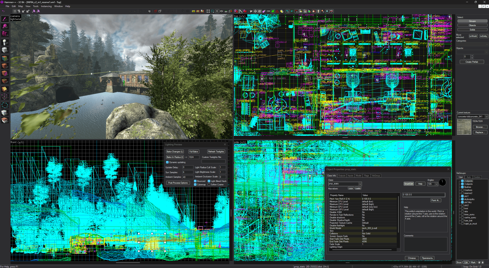

<p align="center"></p>

[English Version](README.md) | Русская версия

## Установка

**Hammer++ должен быть закрыт.**

1. Установите [INFRA](https://store.steampowered.com/app/251110/INFRA/);
2. Скачайте [Hammer++ для Portal 2](https://ficool2.github.io/HammerPlusPlus-Website/download.html) и распакуйте его рядом с патчером;
3. Запустите **infra-hpp-patcher.exe** (если игра установлена, а папка Hammer++ для Portal 2 лежит рядом с патчером, они подставятся автоматически, иначе укажите их вручную);
4. Нажмите **Install**;

## Показ


<p align="center">Hammer++ - INFRA</p>

## Требования

### Общие

- INFRA из Steam
- Hammer++ для Portal 2, 32-битный: патчер принимает только эту сборку

### Для разработчиков

- Rust, stable, с 32-битной целью: `rustup target add i686-pc-windows-msvc`
- Visual Studio \>=2022 или Build Tools с компонентом "Разработка классических приложений на C++": компоновщик MSVC и Windows SDK

## Сборка

```
cargo build --release -p infra_hpp_adapter --target i686-pc-windows-msvc
cargo build --release -p infra_hpp_patcher
```

На выходе `target\release\infra-hpp-patcher.exe`, внутри 32-битная `infra_hpp_adapter.dll`: первая команда собирает адаптер, вторая встраивает его в патчер.

Адреса патчера — в [ADDRESSES.md](ADDRESSES.md).

## Авторы

- Loiste Interactive - Создатели [INFRA](https://loisteinteractive.com)
- Ficool2 - Создатель [Hammer++](https://ficool2.github.io/HammerPlusPlus-Website/) :blue_heart:
- Michael Soyka (Moon-6) - Структура, основные моменты, тесты
- Claude - Основной код патчера
